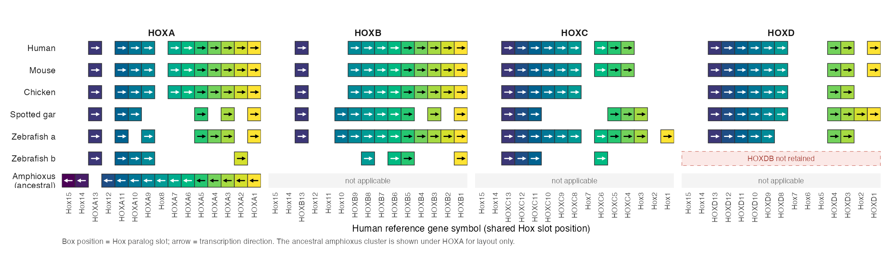
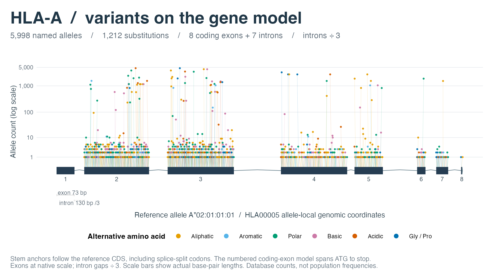
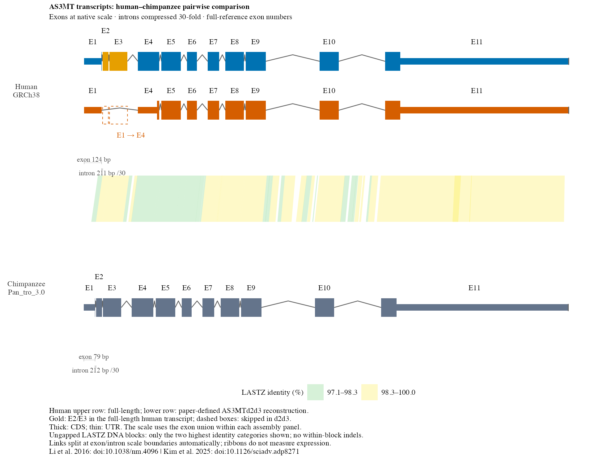
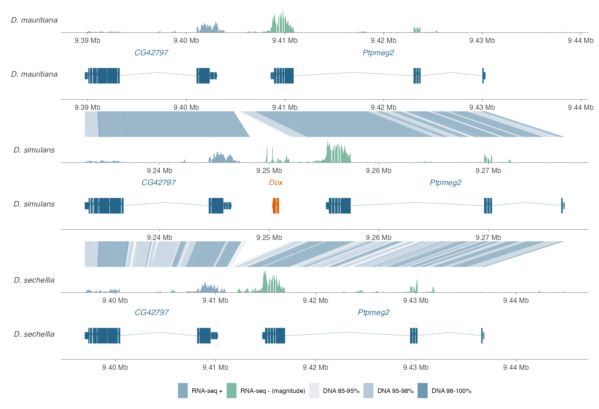

# ggexon

**Grammar of genomic annotations, synteny, and associated data.**

[Documentation and tutorials](https://dongyaoliu.github.io/ggexon/)

`ggexon` is a ggplot2 extension for drawing genomic annotation together with
comparative and track-level data. It was developed while visualizing the
`sept-1`/`zina-1` toxin-antidote locus described in the preprint
[sept-1/zina-1 is an Ancient Toxin-Antidote System in Caenorhabditis elegans](https://www.biorxiv.org/content/10.1101/2025.11.28.691152v1).

The package has two connected parts:

1. S4 classes store genomes, annotation layers, alignments, and reusable layout
   state.
2. Functions load, query, modify, and draw those classes with a ggplot2-style
   grammar.

If you already think in `ggplot2`, the goal is that genomic coordinates,
annotation tracks, alignments, and tree-aligned panels can all be composed with
familiar plotting ideas.

## Flagship HOX Cluster Expansion Example



The bundled HOX cluster-expansion tutorial compares six chordate species in a
seven-row by four-column matrix. HOXA through HOXD show the four vertebrate
cluster families and the duplicated zebrafish `a` and `b` rows. The single
ancestral amphioxus cluster is displayed under HOXA only as a compact layout
anchor; this placement does not assign it specifically to HOXA. Its HOXB--HOXD
cells are structural blanks. A not-retained zebrafish HOXDB cluster and
unoccupied gene slots within retained clusters remain visually distinct.

Genes are drawn with `geom_genebox()` as data-unit squares containing
strand-direction arrows. Its default `box_size = 1` spans one x and y data
unit; `coord_fixed(ratio = 1)` keeps the boxes visually square when the figure
is rendered or exported. `strip_scale_x(slot_order = ...)` aligns every gene to
a shared Hox15-to-Hox1 template, so genes assigned to the same curated
Hox-number slot occupy exactly the same x coordinate. Box position represents
that paralog-slot alignment, whereas the arrow independently represents
transcription direction; amphioxus therefore retains its left-pointing arrows
without breaking homolog-slot alignment. Unoccupied positions remain visible
and do not by themselves imply gene loss. `scale_x_facet_labels()` supplies
cluster-specific human reference gene symbols from an explicit named list,
with `HoxN` fallback labels for slots absent from the human reference cluster.
All facets retain the same fixed x-coordinate range and break positions, so
changing the labels preserves slot alignment and works with
`coord_fixed(ratio = 1)`. Labels are rotated 90 degrees to fit the 15 slots in
each narrow column. The example uses
`theme_ggexon_clean()` to remove panel outlines and facet-strip backgrounds.
The tutorial removes nucleotide and synteny links, and also demonstrates
initiation, genomic coding-midpoint, and stop anchor modes on the human HOXA
cluster, with any
terminal-CDS positional proxies flagged in the bundled data. Its
annotations are pinned to Ensembl release 116 for vertebrates and Ensembl
Metazoa release 63 for amphioxus.

Open `vignette("hox-cluster-expansion-demo", package = "ggexon")` for the full
example, selected-transcript provenance, and source audit trail.

## HLA-A Alleles on an Exon–Intron Gene Model



The HLA-A tutorial summarizes 5,998 eligible named alleles as 1,212 amino-acid
substitutions. It shows both a protein-domain view and a splice-aware projection
onto the exact A*02:01:01:01 reference gene. Exons retain their native scale;
`scale_x_ggexon_genomic(intron_factor = 3)` compresses introns three-fold, with
separate exon and intron scale bars. Counts describe database representation,
not population frequencies.

See the [HLA-A protein and gene-model tutorial](https://dongyaoliu.github.io/ggexon/articles/hla-a-lollipop-demo.html).

## AS3MT Exon Skipping with Intron-Compressed Alignment Links



The AS3MT tutorial compares the human and chimpanzee full-length transcripts
with a paper-defined human AS3MTd2d3 reconstruction. `geom_exon2()` distinguishes
CDS from UTR, and `scale_x_ggexon_genomic(intron_factor = 30)` compresses introns
while retaining exon widths. `geom_nuclink()` automatically subdivides raw
genomic alignment blocks at both panels' scale boundaries and maps the pieces
to the same exon/intron scales. The plot retains only the two highest identity
categories of the ungapped LASTZ alignment.

The tutorial also aligns matched human GTEx coverage and counted splice
junctions to the compressed gene model. `geom_junction()` distinguishes
exon inclusion from E1→E4 skipping, while preserving source signal values.

See the [AS3MT transcript, DNA and RNA-seq tutorial](https://dongyaoliu.github.io/ggexon/articles/as3mt-splice-variants-demo.html)
for the reproducible offline example and aligned DNA repeat detail.

## Compact Three-Species Dox Synteny



This offline example compares *D. mauritiana*, *D. simulans*, and
*D. sechellia*, with 2/3/2 displayed genes and two nucleotide-link panels.
Each species has a separate RNA-seq subpanel above its annotation.
It connects conserved gene order to exon structure, local DNA alignments,
and testis RNA-seq. The additional `Dox` model contains three coding exons
mapped exactly from the published CDS. RNA-seq is shown for all three
species. The full *D. simulans* replicate-1 read library is remapped directly
to the plotted assembly; the two outer species retain deposited signals.
Both original genomic scale and gap compression are demonstrated.
`facet_genomics(coverage_panel_height = 0.5, link_panel_height = 0.5)` sets
annotation : link : RNA heights to 1 : 0.5 : 0.5. Independent RNA y limits make
all three peaks similarly tall while preserving signal values. Dsim read
depth and the outer-species deposited signal units are identified separately.

The detailed `vignette("dox-synteny-demo", package = "ggexon")` constructs
`SynIndividual`/`SynSpecies` data objects from bundled GTF, PAF, and BigWig
files, then adds annotations, linkage, and RNA-seq layer by layer. Model
descriptions, signal units, and source details are in the tutorial text.

## Installation

`ggexon` is currently a development package.

```r
install.packages("remotes")
remotes::install_github("DongyaoLiu/ggexon")
```

Some dependencies are from Bioconductor. If your R installation cannot resolve
them automatically, install them first:

```r
install.packages("BiocManager")
BiocManager::install(c(
  "Biostrings",
  "GenomeInfoDb",
  "GenomicRanges",
  "Rsamtools",
  "rtracklayer"
))
```

For ODGI-backed graph alignment workflows, install the system tools listed in
`DESCRIPTION`:

- Python 3.8 or newer
- `odgi`

## Package Map

### Part 1: Classes Store Data

The core data containers are:

| Class | Role |
| --- | --- |
| `SynSpecies` | Project-level container for individuals, alignments, trees, and layout state |
| `SynIndividual` | One genome, strain, species, or sample |
| `SynFeatureAnnotation` | Genes, transcripts, exons, CDS, labels, and annotation patches |
| `SynVCFAnnotation` | VCF querying is supported. BCF parsing is not implemented; BCF input raises an unsupported-format error. |
| `SynBigWigAnnotation` | Signal tracks queried by genomic interval |
| `SynProteinDomainAnnotation` | Protein-domain intervals from InterProScan-like tables |
| `SynProteinMutationAnnotation` | Protein mutation summaries for lollipop-style tracks |
| `HomologyAnnotation` | Cross-species gene homology mappings from BLAST results |
| `SynPairAlignment` | Pairwise genome links from PAF, PSL, or ODGI-derived data |
| `SynMultiAlignment` | Stores already parsed MAF data supplied through `data`; loading a MAF file remains unavailable. ODGI-backed loading is available. |
| `SynLayout` | Stored panel windows and layout decisions |

### Part 2: Functions Manipulate and Draw Classes

The public API is organized around a few function families:

| Task | Main functions |
| --- | --- |
| Build object graphs | `add_individual()`, `add_annotation()`, `add_homology_annotation()`, `add_pairwise_alignment()`, `add_multiple_alignment()`, `add_tree()` |
| Load and query data | `load_annotation()`, `load_alignment()`, `import_blast_homology()`, `query_features()`, `query_variants()`, `query_signal()`, `query_domains()` |
| Derive sequence/protein data | `extract_cds_seq()`, `translate_protein()`, `project_domains_to_genome()` |
| Subset and curate objects | `subset_species()`, `subset_individual()`, `subset_pairwise_alignment()`, `set_gene_labels()`, `patch_annotation_from_gff()` |
| Draw genomic layers | `ggexon()`, `geom_exon()`, `geom_coverage()`, `geom_junction()`, `geom_genetag()`, `geom_genebox()`, `geom_genelabel()`, `geom_nuclink()`, `geom_synteny_link()`, `geom_protein_lollipop()` |
| Arrange panels and guides | `facet_genomics()`, `scale_panel_annotation()`, `scale_panel_coverage()`, `center_panel_annotation()`, `facet_genomictree()`, `scale_x_ggexon_genomic()`, `scale_x_facet_labels()`, `guide_x_ggexon_piecewise()` |
| Style plots | `theme_ggexon_clean()`, `theme_ggexon_base()`, `theme_ggexon_track()`, `theme_ggexon_pairwise()` |

The typical workflow is:

```r
library(ggexon)

x <- SynIndividual(
  genome_file = "genome.fasta",
  annotation_file = "annotation.gff3",
  id = "sample"
)

sp <- SynSpecies(name = "project") |>
  add_individual(x)

ggexon(sp) +
  geom_exon(species = "sample", chr = "chr1")
```

## Learn More

The package site contains the longer cookbook-style documentation:

- `vignette("ggexon-classes-and-verbs", package = "ggexon")` for the class
  model, every geom, facet systems, and the genomic guide.
- `vignette("ggexon-workflow", package = "ggexon")` for a step-by-step workflow
  using individuals, annotations, alignments, and direct plotting.
- `vignette("cd44-splice-variants-demo", package = "ggexon")` for human and mouse
  splice variants, LASTZ links, sequence windows, and supporting tables stored
  together in one `SynSpecies` object.
- `vignette("hox-cluster-expansion-demo", package = "ggexon")` for the
  Ensembl-pinned HOX cluster matrix, exact curated Hox-number slots, and
  `geom_genebox()` anchor modes.
- `vignette("bigwig-coverage-demo", package = "ggexon")` for thirteen independent
  raw-depth BigWig panels with automatic span-weighted median-at-85%-height
  scales above one shared, centered gene annotation.
- `?ggexon` and the reference index for function-level documentation.

If you use `ggexon` in work, please also cite the preprint:

> Liu D, Zheng C. sept-1/zina-1 is an Ancient Toxin-Antidote System in
> Caenorhabditis elegans. bioRxiv. 2025.
> <https://www.biorxiv.org/content/10.1101/2025.11.28.691152v1>
