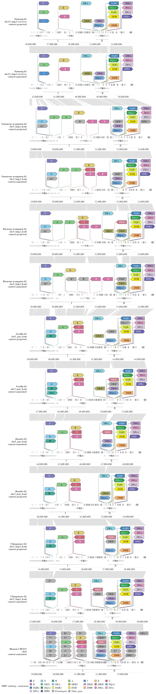
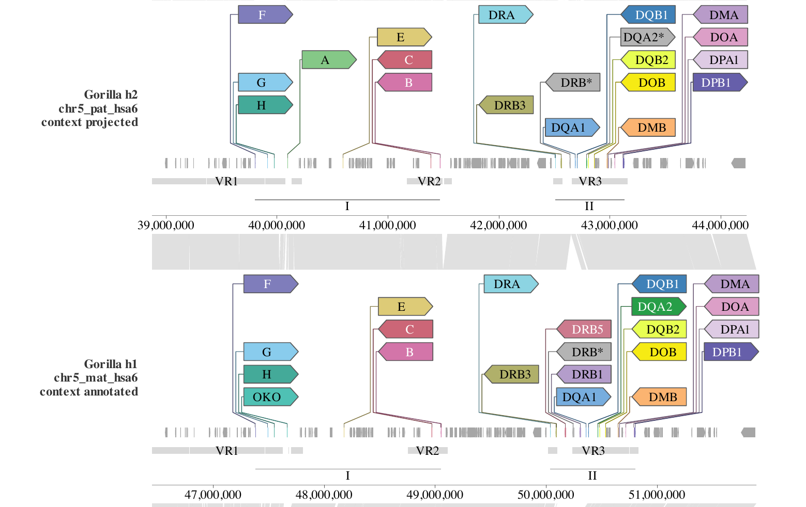

```{r setup, include = FALSE}
knitr::opts_chunk$set(
  collapse = TRUE, comment = "#>", fig.width = 9, fig.height = 6, dpi = 150
)
```

This article builds the MHC haplotype figure step by step: inspect the data,
put every haplotype on one scale, add genes, then the enlarged MHC heads, then
the nucleotide links, and finally the facet layout that sets the link-panel
height. The view recombines the gene identity and
status information of Extended Data Fig. 3a/b with the continuous region and
alignment design of Fig. 3c in
[Yoo et al. (2025)](https://www.nature.com/articles/s41586-025-08816-3). It is a
source-backed reconstruction, not a pixel reproduction of the published figure.

The finished figure puts MHC class I, the intervening region and class II on one
continuous native-coordinate track per haplotype. It contains 13 annotation
tracks (human CHM13 plus both haplotypes of six ape species), 12 adjacent
nucleotide-link panels, 285 curated MHC genes and a common base-pair scale.

```{r fig-final, echo = FALSE, out.width = "100%", fig.alt = "Tall thirteen-track MHC haplotype comparison. Each row is one haplotype with small native gene arrows, enlarged labelled MHC heads, grey context genes, variable-region bars and class I/II spans; grey ribbons between rows show adjacent nucleotide alignments. Human CHM13 is at the bottom, followed upward by both haplotypes of chimpanzee, bonobo, gorilla, Bornean orangutan, Sumatran orangutan and siamang."}

```

```{r fig-classii, echo = FALSE, out.width = "100%", fig.alt = "Two gorilla haplotypes compared at MHC class II, showing enlarged directional gene heads on shared rows, small native-span arrows, grey context genes and grey nucleotide ribbons."}

```

The class II detail isolates the two gorilla haplotypes. It shows the small
native arrows and enlarged heads from Steps 3-4 and the ribbons from Step 5.
The exact code below also adds the VR lane and the class I/II spans before the
facet call.

## Step 1. What is in the MHC data?

All inputs are tab-separated tables under
`data-raw/ape_paper/results/mhc_continuous/`. The main files are:

| File | One row per | Key columns |
|---|---|---|
| `windows.tsv` | haplotype window | `track`, `label`, `chr`, `start0`, `end0`, `length`, `orientation` |
| `gene_models_with_recovered_context/models.tsv` | representative transcript | `track`, `model_id`, `gene_symbol`, `chromStart`, `chromEnd`, `strand`, `annotation_evidence`, `projection_coverage`, `projection_identity` |
| `gene_models_with_recovered_context/exons.tsv` | supporting exon | `model_id`, `start0`, `end0` |
| `mhc_full/genes.tsv` | curated MHC gene | `track`, `locus`, `start`, `end`, `strand`, `gene_name`, `functionality` |
| `links.tsv` | alignment block | `tspecies`, `qspecies`, `tstart`, `tend`, `qstart`, `qend`, `strand`, `identity` |
| `discordant_regions.tsv` | variable-region piece | `track`, `region`, `start0`, `end0`, `display_start0`, `display_end0` |
| `source_metadata/mhc_continuous/colors.txt` | ortholog key | gene key, RGB |

Coordinate conventions matter here: `windows.tsv` and the derived tables use
BED0, half-open coordinates (`start0`, `end0`). The curated `genes.tsv` table
stores one-based closed coordinates (`start`, `end`), so the renderer converts
`start` to `start0 = start - 1` before plotting.

Representative rows look like this:

```text
windows.tsv
track   label          chr             start0     end0       length    orientation
SSYh1   Siamang h1     chr23_hap1      37530567   42365376   4834809   -
PTRh1   Chimpanzee h1  chr5_hap1_hsa6  34745920   40035224   5289304   +
HSAh1   Human CHM13    chr6            28669878   33979214   5309336   +

genes.tsv
track   locus   start      end        strand  gene_name  functionality
HSAh1   MHC_I   29595529   29610626   +       HLA-F      functional

links.tsv
tspecies  qspecies  tstart  tend     qstart  qend     identity
SSYh2     SSYh1     1       113549   1       113407   97.9
```

The curated table has **285** records. `functionality` is the source call
(`functional` or `pseudogene`); `locus` separates class I from class II; and
`gene_name` supplies the identity key used for colors and for the shared head
rows. The context tables contain released models and explicitly labelled
same-species Liftoff projections, with `annotation_evidence` distinguishing the
two.

```{r inputs, eval = FALSE}
B <- "data-raw/ape_paper/results/mhc_continuous"

windows <- read.delim(file.path(B, "windows.tsv"))
links   <- read.delim(file.path(B, "links.tsv"))
regions <- read.delim(file.path(B, "discordant_regions.tsv"))
models  <- read.delim(file.path(B, "gene_models_with_recovered_context/models.tsv"))
exons   <- read.delim(file.path(B, "gene_models_with_recovered_context/exons.tsv"))
mhc     <- read.delim("data-raw/ape_paper/results/mhc_full/genes.tsv")
```

## Step 2. Put every haplotype on one scale

This is the part that is easy to misread. Each track comes from a **different
assembly window**. Human starts at 28.7 Mb, chimpanzee at 34.7 Mb, and siamang
at 37.5 Mb; the windows also differ in length (4.79-5.80 Mb) and siamang is
stored in the reverse orientation. If you plotted the raw coordinates on one
x-axis, the rows would not line up and one base pair would have a different
width in each row.

The figure therefore converts every native coordinate to a **display
coordinate** that starts at 0 for every track:

- plus orientation: `display = native - window_start`
- minus orientation: `display = window_end - native`

For example:

| track | native window (`start0`-`end0`) | orientation | feature start | display |
|---|---|---:|---:|---:|
| HSAh1 | 28,669,878-33,979,214 | + | 28,670,000 | 122 |
| PTRh1 | 34,745,920-40,035,224 | + | 34,746,500 | 580 |
| SSYh1 | 37,530,567-42,365,376 | - | 42,364,000 | 1,376 |

The display coordinate is a **drawing coordinate**, not a biological one. It
makes every track start at the left edge of the page. A reverse-oriented track
is reflected, so its genes run in the comparable left-to-right order. Because
the longest window defines the display range, one base pair occupies the same
horizontal distance in all 13 rows. That is what allows the gene positions and
the ribbons to line up.

```{r native-geometry, eval = FALSE}
transform_native <- function(d, a, b, trackcol = "track") {
  z  <- windows[match(d[[trackcol]], windows$track), ]
  lo <- pmax(d[[a]], z$start0)   # clip features that cross the window edge
  hi <- pmin(d[[b]], z$end0)
  d$xmin <- ifelse(z$orientation == "+", lo - z$start0, z$end0 - hi)
  d$xmax <- ifelse(z$orientation == "+", hi - z$start0, z$end0 - lo)
  d
}

max_bp <- max(windows$length)   # shared bp-to-display scale for every track
```

Native coordinates are not discarded. The tick labels are rebuilt from
`windows.tsv` at the end, so each row still shows its own assembly coordinates
even though all rows share the display geometry.

Next, the per-track annotation and the adjacent pairwise alignments are stored
in one `SynSpecies` object. The 12 alignments are what the link panels will use.

```{r synspecies, eval = FALSE}
sp <- SynSpecies(name = "continuous_MHC")

for (id in windows$track) {
  # the renderer writes a tiny curated GFF from the MHC spans for this track
  sp <- add_individual(
    sp,
    load_annotation(SynIndividual(id = id, annotation_file = gff_for(id),
                                  annotation_format = "gff"))
  )
}

pair_names <- character()
for (i in seq_len(nrow(windows) - 1L)) {
  nm <- paste(windows$track[i], windows$track[i + 1L], sep = "__")
  pair_names <- c(pair_names, nm)
  sp <- add_pairwise_alignment(sp, SynPairAlignment(
    nm,
    target_individual = windows$track[i],
    query_individual  = windows$track[i + 1L],
    data = links_for_pair(i)
  ))
}

sp <- store_chain_layout(sp, free = list(x = TRUE, y = TRUE))
```

## Step 3. Genes first with `geom_gene()`

The first layer is the gene annotation. There are two kinds of arrows:

- **Context genes** are representative source transcripts outside the curated
  MHC set. They are drawn in neutral grey with `geom_gene()`.
- **Native MHC arrows** are one small arrow per curated MHC gene, using the
  exact curated native span and the source ortholog color. They sit in the same
  lane as the context genes.

Neither layer draws exon glyphs: the transcript structure is used for model
selection, but the figure shows one span per representative gene. Helper objects
such as `gff_for()`, `links_for_pair()`, `strip_labels`, `panel_limits` and
`class_spans` are built a few lines earlier in the renderer and omitted here so
that the layer code stays readable. `models` and `mhc` in the code below are
the transformed tables from Step 2 (the renderer calls the model table `m`), so
their `xmin` and `xmax` columns are already display coordinates.

```{r genes, eval = FALSE}
context_arrows <- data.frame(
  track = models$track,
  xmin = models$xmin, xmax = models$xmax, ymin = -0.5,
  transcripts = models$model_id,
  strand = models$strand,
  kind = models$kind
)

native_mhc_arrows <- data.frame(
  track = mhc$track,
  xmin = mhc$xmin, xmax = mhc$xmax, ymin = -0.5,
  transcripts = paste0("curated_native_mhc_", seq_len(nrow(mhc))),
  strand = mhc$display_oriented_strand,
  ortholog_fill = mhc$ortholog_fill
)

p <- ggexon(sp) +
  geom_gene(
    data = context_arrows,
    aes(xmin = xmin, xmax = xmax, ymin = ymin, transcripts = transcripts,
        strand = strand, track = track, fill = kind),
    exon_height = 0.5, colour = NA
  ) +
  geom_gene(
    data = native_mhc_arrows,
    aes(xmin = xmin, xmax = xmax, ymin = ymin, transcripts = transcripts,
        strand = strand, track = track, fill = I(ortholog_fill)),
    exon_height = 0.5, show.legend = FALSE
  )
```

`xmin`/`xmax` are display coordinates, `ymin` is the bottom of the gene lane,
`transcripts` groups the rows, and `strand` controls the arrow direction.
`fill = I(ortholog_fill)` bypasses the ggplot2 color scale, so each native arrow
keeps the exact RGB value from `colors.txt`. The shared legend is supplied by
the heads in the next step, not by this layer.

At this point `p` contains only the gene arrows: no heads and no ribbons.

## Step 4. Add the MHC heads with `geom_gene_lollipop()`

Many MHC genes are only a few kilobases long, too small for a readable label at
the native scale. The figure therefore adds one enlarged directional head per
gene, anchored at the midpoint of the same curated span. The head is a fixed
physical size; the small native arrow still carries the true span.

The curated table is extended with these plotting columns:

| Column | Meaning |
|---|---|
| `true_midpoint` | midpoint of the curated span in display coordinates |
| `display_oriented_strand` | strand flipped for a reverse-oriented track |
| `gene_label` | source gene name, with `*` for a pseudogene |
| `kind` | color/legend key (ortholog class, pseudogene, other gene) |
| `head_row` | one of six shared physical rows for that source gene key |

`head_row` is the key to the layout. Each of the 41 source gene keys is assigned
a fixed row (1-6) from a template, so the same gene appears at the same height
in every haplotype even when its native position differs. Distinct duplicated
copies remain separate heads and are placed side by side on that row. An empty
slot is a layout vacancy, not evidence that the gene is absent.

```{r heads, eval = FALSE}
p <- p + geom_gene_lollipop(
  data = mhc,
  aes(x = true_midpoint, y = 0, strand = display_oriented_strand,
      label = gene_label, fill = kind, track = track, head_row = head_row),
  headroom = 8,
  head_layout = "columns",
  head_height_mm = 4,
  padding_mm = 0.6,
  tip_mm = 1.8,
  gap_mm = 0.8,
  row_gap_mm = 0.8,
  stem_height_mm = 1.5,
  family = "Times",
  size = 8 / ggplot2::.pt
)
```

`y = 0` is the gene anchor line and `headroom = 8` is the y-space above it that
the heads may use. The `*_mm` arguments are physical sizes, not data units, so
the heads stay legible when the figure is exported at 180 mm width. The stems
rise from the exact midpoint ticks and fan into their columns; the layout is
measured later and converted into panel heights.

## Step 5. Connect haplotypes with `geom_nuclink()`

The last data layer is the nucleotide links. One `geom_nuclink()` call is added
for each adjacent pair of haplotypes, using the stored `SynPairAlignment`:

```{r links, eval = FALSE}
for (nm in pair_names) {
  p <- p + geom_nuclink(
    alignment = nm,
    fill = "grey60",
    colour = NA,
    alpha = 0.3
  )
}
```

Each row of `links.tsv` is one ungapped alignment block: an interval on the
target track (`tspecies`, `tstart`, `tend`) aligned to an interval on the query
track (`qspecies`, `qstart`, `qend`), with `strand` and `identity`. The layer
maps both intervals into the link panel between the two annotation rows and
draws a quadrilateral (four vertices) for the block. In this figure there are
**624 blocks** across the 12 adjacent pairs, all drawn with the same grey fill
and transparency.

The blocks were regenerated with minimap2 `asm20` from the exact extracted
native sequences, not taken from the unavailable original Fig. 3c plot data.
Blocks are split at indels of at least 1 kb; blocks shorter than 500 bp or from
parent alignments below 70% identity are omitted for display.

### What the ribbons are - and are not

The ribbons are **pairwise alignments**, not a difference track. They show
where two haplotype sequences align and where the alignment breaks. They do not
measure base-level nucleotide differences, expression, or repeat copy number.
`identity` is stored in the table and could be mapped to `fill`, but this figure
keeps every ribbon grey.

If by "replica sequence" you mean duplicated or repetitive sequence: the links
do not classify repeats. A tandem array or a duplication may produce repeated
or non-colinear blocks, and an indel appears as a break between blocks, but
that is an alignment pattern, not a repeat call. Repeats and segmental
duplications need a separate annotation layer; they are not inferred from the
ribbons.

## Step 6. Tune the link panels with `facet_genomics()`

The script also adds the VR1-VR3 lane and the class I/II spans before faceting.
They are ordinary annotations below the gene anchors:

```{r annotations, eval = FALSE}
p <- p +
  geom_rect(
    data = regions,
    aes(xmin = xmin, xmax = xmax, ymin = ymin, ymax = ymax),
    fill = "grey85", colour = NA, inherit.aes = FALSE
  ) +
  geom_segment(
    data = class_spans,
    aes(x = xmin, xend = xmax, y = y, yend = y),
    colour = "grey55", inherit.aes = FALSE
  )
```

The renderer computes the shared VR lane's `ymin` and `ymax` from `vr_top` and
`vr_height`; `regions` supplies the x intervals.

Faceting now creates one annotation panel per track and one link panel between
each adjacent pair. The ratio between those two panel types is controlled by
`link_panel_height`:

```{r facet, eval = FALSE}
p <- p +
  facet_genomics(
    vars(track),
    scales = "free",
    ncol = 1,
    strip.position = "left",
    link_panel_height = 0.35,
    link_axis = "none",
    link_strip = "blank",
    labeller = labeller(track = strip_labels)
  ) +
  scale_panel_annotation("free_y", limits = panel_limits) +
  theme_ggexon_track(base_family = "Times", base_size = 8,
                     show_x_grid = FALSE) +
  theme_ggexon_side_strips("left", base_size = 8)
```

`link_panel_height` is a **relative** height, not a millimetre value. A positive
number is turned into a `null` grid unit relative to an ordinary panel row, so
`0.35` makes each link panel roughly 35% of a standard annotation panel. Raise
it when the ribbons are too flat to read; lower it when the links dominate the
figure. Values around 0.2-0.5 are usually enough. The final export later fixes
the link panels at 8 mm after measuring the heads, because the annotation
panels shrink or grow around their labels.

`scales = "free"` frees the y range for each annotation panel. The x limits
are still the same `[0, max_bp]` range on every track, so the base-pair scale
stays common even though the facet is "free"; the per-panel y limits are
supplied through `scale_panel_annotation()`.
`link_axis = "none"` removes the axes from the link strips and
`link_strip = "blank"` removes their strip labels. The left-side track labels
come from `theme_ggexon_side_strips()`.

## Step 7. Measure the layout, fix the axes and export

The figure is 180 mm wide, but its height cannot be fixed in advance: each MHC
head contains a label whose rendered width depends on the font and the number
of columns. The renderer therefore draws the gtable once on a roomy 1000 mm PDF
and records every head's device position through the `layout_callback` of
`geom_gene_lollipop()`. It then gives each annotation panel exactly the height
its heads need and gives every link panel a fixed 8 mm.

Native axes are rebuilt in the same pass. The default bottom axis of each
annotation panel is replaced with ticks in that track's own one-based assembly
coordinates; reverse-oriented tracks count down. Because the axis grobs are
positioned through the shared display geometry, the tick spacing still proves
the common base-pair scale.

```{r export, eval = FALSE}
built <- ggexon_build(p)
tab   <- ggexon_gtable(built)

# heads measured, panel heights assigned, native axes installed here

ggsave("mhc_continuous.pdf", tab, width = 180, height = measured_height_mm,
       units = "mm", device = cairo_pdf, bg = "white")
ggsave("mhc_continuous.png", tab, width = 180, height = measured_height_mm,
       units = "mm", dpi = 150, bg = "white")
```

The script fails loudly if the built object does not match the intended design.
Its assertions and exported QC tables check, among other things:

- 13 annotation panels, 12 link panels, no coverage panel;
- one identical bp-per-axis-unit value across all annotation scales;
- 285 heads at the true midpoints, with the recorded strand, label and row;
- 624 ribbon blocks, four vertices per block, correct target/query ownership;
- the shared VR lane, panel heights, figure dimensions and axis round-trips.

The QC outputs are written beside the figure as
`common-bp-scale-qc.tsv`, `native-geometry-qc.tsv`, `native-axis-qc.tsv`,
`annotation-height-qc.tsv`, `link-qc.tsv`, `layout-qc.tsv` and
`figure-dimensions.tsv`, together with the plotted tables.

## Reading the figure

The small arrows retain each gene's true curated span and source ortholog
color; the enlarged heads carry the readable labels and direction on six shared
rows. An empty head slot is a layout vacancy, not evidence that the gene is
absent. Occupied slots are read top to bottom within a column, then left to
right.

The grey VR1-VR3 bars are the published CHM13 variable-region intervals on the
human track. On the ape tracks they show only the portions projected through
human-to-ape chain blocks, so they describe shared comparative regions rather
than independent ape-specific discordance. Asterisks mark pseudogene calls
from the source annotation, not experimental validation.

Context layers labelled "projected" are same-species Liftoff transfers that
passed at least 95% exon coverage and 95% sequence identity. Five alternative
shorter isoforms were recovered at the same threshold; nine complete models
remain unresolved. Recoveries use shorter source isoforms, and their RNA
support is partial and not haplotype-resolved. Projected context is
visualization context, not a complete validated alternate-haplotype gene
catalog, and gene counts have different ascertainment across released and
projected tracks. The region boundaries and adjacent alignments are documented
reconstructions, not exact reproductions of the source figure.

The finished figure is exported at 180 mm width; its height is measured from
the head layout rather than fixed in advance. The vector PDF is kept in
`data-raw/ape_paper/results/mhc_continuous/figures/`, and the PNG preview is
shown above.

## Reproducing the figure

The bounded inputs and the rendered figure are tracked under
`data-raw/ape_paper/results/mhc_continuous/`. From the repository root:

```sh
Rscript data-raw/ape_paper/render_mhc_continuous.R
```

That command uses the final merged inputs and writes both figure formats and
the QC tables. Rebuilding the inputs from raw sources additionally requires the
bounded fetch, Liftoff projection, minimap2 and recovery steps documented in
`data-raw/ape_paper/results/mhc_continuous/README.md`. `data-raw/` is source
material and is not installed with the package, so this vignette embeds the
final PNG preview instead of re-running the renderer.
